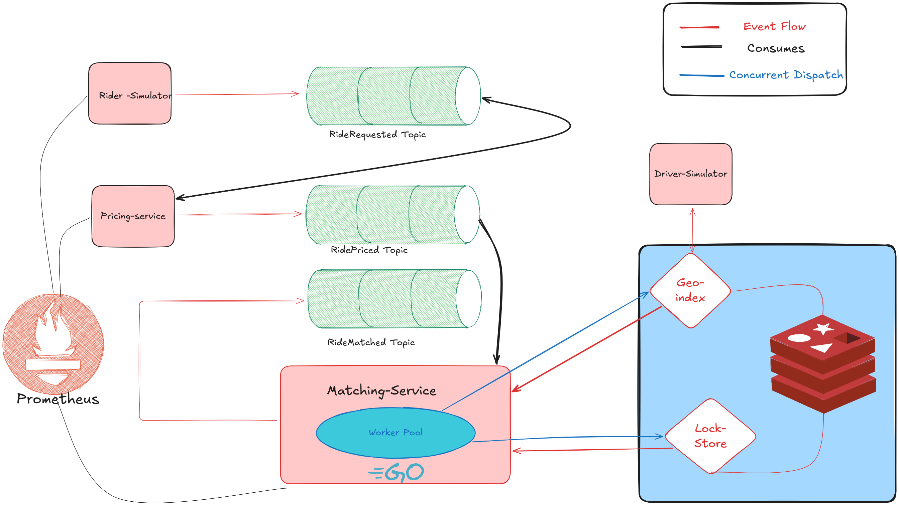

# RidePulse

Event-driven ride matching in Go: Kafka between every stage, Redis GEO for nearby-driver search, atomic Redis locks for driver assignment, and Prometheus metrics end to end, load-tested with an automated RPS ladder.

[](https://github.com/coderconnoisseur/ridepulse/actions/workflows/ci.yml)


## Results at a glance

From the committed benchmark run ([`benchmark-results.csv`](tools/benchmark/benchmark-results.csv); Windows dev box, single-partition Kafka, single Redis). These numbers predate the at-least-once consumer and driver-state changes: drivers now stay busy for `DRIVER_TRIP_DURATION`, so the ladder must be re-run before results are comparable.

- **50 RPS:** 99.7 % of rides matched, end-to-end p50 34 ms / p95 94 ms (gateway to assignment).
- **Peak throughput:** the gateway took in ~400 RPS; the pipeline completed ~150 assignments/sec.
- **Matching stayed fast under load:** successful-match p95 was 33–84 ms at every step up to 800 RPS target.
- **Where it breaks:** success drops to 66 % at 200 RPS and below 50 % from 300 RPS, and end-to-end p95 hits the 10 s histogram cap. The primary bottleneck identified is matcher worker-pool starvation (see [Known limitations](#known-limitations-and-next-steps)).

**Core focus areas:**
- Low-latency geospatial matching
- High-concurrency locking with explicit phantom-lock release
- Contention-aware batching and progressive deadline hierarchy
- Observability-driven performance tuning end-to-end

---

## Architecture Overview

RidePulse follows an event-driven microservices design where each component has a single, well-scoped responsibility:



*The diagram shows the core Kafka/Redis pipeline. The API gateway (in front of `ride.requested`) and the assignment service (consuming `ride.matched`) are shown in the table and in [Request Flow](#request-flow) below.*

| Component | Role |
|---|---|
| **Rider Simulator** | Generates ride requests at configurable RPS against the HTTP gateway |
| **API Gateway** | Accepts `POST /rides`, publishes `ride.requested` to Kafka |
| **Pricing Service** | Consumes `ride.requested`, computes fare, publishes `ride.priced`; failures retried, then dead-lettered to `ride.requested.dlq` |
| **Matching Service** | Consumes `ride.priced`, runs geospatial search + atomic driver locking, assigns the driver (idempotent per ride), publishes `ride.matched`; business failures (`no_drivers`, `match_deadline`) publish `ride.unmatched`; infrastructure failures retried, then dead-lettered to `ride.priced.dlq` |
| **Assignment Service** | Consumes `ride.matched` and `ride.unmatched`, records each ride's outcome once (duplicates ignored), exposes end-to-end latency metrics and `GET /rides/<id>`; dead-letters to `ride.matched.dlq` / `ride.unmatched.dlq` |
| **Driver Simulator** | Continuously updates live driver locations in Redis GEO; keeps assigned drivers out of the GEO set and releases them after `DRIVER_TRIP_DURATION` |
| **Kafka** | Decouples every stage of the pipeline |
| **Redis** | GEO indexing, distributed driver locking (Lua safe-unlock) and driver assignment state |
| **Prometheus** | Latency, contention, and success-rate monitoring at every stage |

---

## Request Flow

```
RiderSimulator ──HTTP POST /rides──▶ API Gateway
                                        │  (stamps RequestedAt)
                                        ▼
                                Kafka: ride.requested
                                        │
                                        ▼
                                 Pricing Service
                                        │
                                        ▼
                                 Kafka: ride.priced
                                        │
                                        ▼
                                 Matching Service
                                        │
                                        ├── Redis GEORADIUS → nearby drivers
                                        ├── tier-preserving shuffle
                                        ├── SETNX + TTL → atomic driver lock
                                        │   (batch losers explicitly released)
                                        ├── atomic assign: driver:assigned, ride:driver,
                                        │   remove from GEO (replays return same driver)
                                        ├─ matched ──▶ Kafka: ride.matched
                                        └─ no driver / deadline ──▶ Kafka: ride.unmatched
                                        │
                                        ▼
                                Assignment Service
                                        │
                                        ▼
              records the ride's outcome once; end_to_end_latency
              (GET /rides/<id> returns matched or unmatched)
```

---

## Core Engineering Decisions

### 1. Geospatial Indexing with Redis GEO

Driver locations are stored and queried using Redis's native GEO commands, enabling sub-millisecond radius-based lookups without a dedicated spatial database. This keeps the hot path lean and the driver discovery step real-time.

### 2. Atomic Driver Locking with phantom-lock release

```
SETNX driver:lock:<id> <ride_id> EX 3
```

Each driver is locked atomically before assignment. Because the matcher races 5 goroutines per batch and any of them can `SETNX`-win, the batch race can produce **more than one successful lock per ride**. The extras are released via a Lua `GET`-then-`DEL` safe-unlock so they never sit in Redis as phantom locks blocking future rides. The `driver_lock_released_phantom_total` counter makes this visible.

Full write-up: [phantom-lock-fix.md](docs/phantom-lock-fix.md).

### 3. Tier-preserving batch shuffle

`GEORADIUS` returns drivers nearest-first — the signal we want to preserve. But under a demand hotspot, every ride's "top 5 nearest" is the same set, and pure nearest-first cascades into lock contention. Full random shuffle destroys the geospatial signal entirely.

The matcher shuffles **within** distance tiers of size 10, keeping tier order intact. Under spread load this recovers pure nearest-first; under hotspot load it spreads contention across the top-10 instead of pinning it to the top-5, without ever trying a farther driver before a nearer one.

Full write-up: [shuffle-nearest-first-fix.md](docs/shuffle-nearest-first-fix.md).

### 4. Progressive Parallel Locking with hierarchical deadlines

Each match has its own budget (`MATCH_DEADLINE`, default 500 ms; the write-up below was done at 800 ms); each batch of 5 parallel `SETNX` attempts has a 200 ms budget nested inside it; Kafka publish gets its own independent 300 ms budget so a slow match can't starve the publish RTT.

Full write-up: [deadline-fix.md](docs/deadline-fix.md).

### 5. At-least-once consumers with ordered commits and DLQs

Pricing, matching and assignment share one runner (`pkg/kafkaconsumer`). An offset is committed only after its message, and every earlier message of the partition, was handled or dead-lettered, so a crash redelivers instead of losing work. Failed handlers are retried with backoff, then written to `<topic>.dlq` with `x-error` / `x-original-*` headers; a handler panic is dead-lettered without retries instead of crashing the process; a consumer-group rewind starts a new tracker epoch so stale completions cannot corrupt commits; shutdown drains in-flight messages for up to 10 s.

Full write-up: [at-least-once-consumers.md](docs/at-least-once-consumers.md).

### 6. Driver state model and idempotent matching

A matched driver is now genuinely busy: matching atomically sets `driver:assigned:<id>`, writes `ride:driver:<rideID>` and removes the driver from the GEO set; the driver simulator ends the trip after `DRIVER_TRIP_DURATION` (default `5s`). Because `Match` first checks `ride:driver:<rideID>`, a retry or Kafka redelivery returns the same driver instead of assigning a second one.

Full write-up: [driver-state-model.md](docs/driver-state-model.md).

### 7. Worker Pool with Bounded Concurrency

The shared consumer runner (`pkg/kafkaconsumer`) hands each fetched message to a fixed number of workers over an unbuffered channel. This provides natural backpressure — if handlers fall behind, fetching blocks rather than spawning unbounded goroutines or buffering messages, preventing memory blowup under load spikes.

### 8. Observability-Driven Tuning

Every stage exposes Prometheus metrics on its own port. `RequestedAt` is stamped at the api-gateway and propagated through every event so the terminal consumer can measure true end-to-end latency, not just per-stage latency.

Key exports:
- `gateway_request_duration_seconds`, `gateway_requests_total`, `gateway_publish_errors_total`
- `pricing_processing_duration_seconds`, `pricing_events_published_total`
- `matching_latency_seconds`, `matching_success_total`, `matching_failures_total`, `match_unmatched_published_total{reason}`
- `driver_lock_conflict_total`, `driver_lock_released_phantom_total`
- `end_to_end_latency_seconds`, `assignments_total` (each ride counted once), `assignment_duplicates_total`
- `unmatched_total{reason}`, `unmatched_duplicates_total`, `unmatched_end_to_end_latency_seconds`
- `pricing_retries_total`, `matching_retries_total`, `pricing_dlq_messages_total`, `matching_dlq_messages_total`, `assignment_dlq_messages_total`, `match_idempotent_replays_total`

---

## Benchmarks

The [`tools/benchmark`](tools/benchmark) runner walks a configurable RPS ladder against a running cluster, samples Prometheus at each step, and writes one CSV row per step.

> **Note:** the committed results below predate the at-least-once and driver-state changes. Drivers now stay busy for `DRIVER_TRIP_DURATION` after a match, so supply is finite and the ladder must be re-run before new numbers are comparable with this CSV.

The latest run is committed here:

📊 **[tools/benchmark/benchmark-results.csv](tools/benchmark/benchmark-results.csv)**

Headline from that run (Windows dev box, single-partition Kafka, single Redis, ~8 cores):

| What | Value |
|---|---|
| Peak intake at gateway | ~400 RPS |
| Peak end-to-end assignment throughput | ~150 rides/sec |
| Peak "healthy" throughput (>95 % success) | ~50 RPS |
| Successful `matching_latency_seconds` p95 | stayed 33–84 ms across every step |

The primary bottleneck in that run was matcher pool starvation from slow-fail matches: under contention, ~30 % of matches consumed workers for the full 800 ms match deadline, blowing past the `NumCPU × 5` worker capacity of the time. The matcher defaults have since changed (`MATCH_WORKERS` = `NumCPU × 25`, `MATCH_DEADLINE` = 500 ms) but the new values have **not been measured**; the ladder must be re-run. Fail-fast on batch 1 saturation and multi-partition Kafka topics are still open.

See [rps-benchmarking-setup.md](docs/rps-benchmarking-setup.md) for the runbook, ladder shape, PromQL queries, and interpretation notes.

---

## Known limitations and next steps

- **Matcher pool starvation: new defaults, still unmeasured.** The pool now defaults to `runtime.NumCPU() * 25` workers (`MATCH_WORKERS`) and the match deadline to 500 ms (`MATCH_DEADLINE`), down from `NumCPU * 5` and 800 ms. Slow-fail matches still hold a worker until the deadline, and no ladder has been run with these values, so they are a starting point, not a result. Next: re-run the ladder, and fail fast when the first batch is fully contended instead of waiting out the deadline.
- **Single-partition Kafka topics.** One partition per topic caps consumer parallelism per service. Next: create topics with more partitions, partition by ride ID and run multiple consumers per stage. Until then the rewind handling below is not exercised.
- **Rewind detection is partial.** The offset tracker detects a rewind only when a re-fetched offset is at or below the last offset it tracked. A partition re-assigned starting *above* that offset is not detected, so the committed offset can move backwards and messages are redelivered. That stays within at-least-once, and handlers absorb duplicates.
- **Two readers, two consumer groups.** assignment-service reads `ride.matched` in group `assignment-service` and `ride.unmatched` in group `assignment-service-unmatched`. A shared group would make the leader's metadata request for both topics fail as a whole while `ride.unmatched` does not exist yet (it is created lazily on the first business failure), stalling the success path too; with separate groups a missing `ride.unmatched` topic only delays the unmatched reader, and rebalances are independent.
- **In-memory assignment store.** The assignment service keeps ride outcomes (matched and unmatched) in maps for benchmark verification; nothing is persisted, so after a restart a redelivered event is counted as new.
- **Test coverage is unit-level.** Unit tests cover the tier-preserving shuffle, the at-least-once consumer runner (ordered commits, retries, DLQ, drain, rewind epochs, panic recovery) and the Redis Lua scripts (locking, assignment, release) against an in-process Redis (miniredis). Nothing yet exercises real Kafka/Redis end to end: the unmatched path, the epoch-stamped commits and the new matcher defaults have not been run against a live cluster. Next: integration tests against containerized Kafka and Redis.

---

## Documentation

Deep-dive engineering notes on the correctness and reliability changes:

- 📄 [Phantom-lock race fix](docs/phantom-lock-fix.md)
- 📄 [Deadline hierarchy fix](docs/deadline-fix.md)
- 📄 [Shuffle vs nearest-first fix](docs/shuffle-nearest-first-fix.md)
- 📄 [At-least-once consumers](docs/at-least-once-consumers.md)
- 📄 [Driver state model](docs/driver-state-model.md)
- 📄 [RPS benchmarking setup](docs/rps-benchmarking-setup.md)

---

## Tech Stack

- **Go 1.25** — Concurrency primitives, goroutines, contexts; Gin for the HTTP gateway
- **Kafka** — Event streaming and ingestion decoupling
- **Redis** — GEO indexing and atomic distributed locking (with Lua safe-unlock)
- **Docker Compose** — Infrastructure orchestration
- **Prometheus** — Metrics and observability

---

## Running RidePulse

### Prerequisites

- Docker with Compose (`docker compose`, or the older `docker-compose`)
- Go 1.25.6+ (the version in each `go.mod`)

### 1. Start Infrastructure

From `deployment/`, bring up Kafka, Zookeeper, Redis, and Prometheus:

```bash
cd deployment
docker compose up -d
```

Verify:
- Kafka: `localhost:9092`
- Redis: `localhost:6379`
- Prometheus UI: http://localhost:9090

### 2. Start the services (one terminal each, from the repo root)

```bash
cd services/matching-service   && go run cmd/matching-service/main.go
cd services/pricing-service    && go run cmd/pricing-service/main.go
cd services/assignment-service && go run cmd/assignment-service/main.go
cd services/driver-simulator   && go run cmd/driver-simulator/main.go
cd services/api-gateway        && go run cmd/api-gateway/main.go
```

Prometheus scrape targets:

| Service | `/metrics` endpoint |
|---|---|
| api-gateway | `:8080/metrics` |
| pricing-service | `:2115/metrics` |
| matching-service | `:2112/metrics` |
| assignment-service | `:2114/metrics` |

Confirm all four are `up` at http://localhost:9090/targets.

**Configuration.** Every service reads its endpoints from environment variables; unset or blank values fall back to the defaults below, so the commands above work unchanged on one host. `KAFKA_BROKERS` is a comma-separated list. Invalid values make the services exit at startup, except rider-simulator, which falls back to the default for a non-numeric or non-positive `RIDER_RPS` / `RIDER_CONCURRENCY`; double-check these when running the ladder.

| Variable | Default | Used by | Meaning |
|---|---|---|---|
| `KAFKA_BROKERS` | `localhost:9092` | api-gateway, pricing, matching, assignment | Comma-separated broker list. |
| `REDIS_ADDR` | `localhost:6379` | matching, driver-simulator | Redis address. |
| `HTTP_ADDR` | `:8080` (api-gateway), `:2114` (assignment) | api-gateway, assignment | HTTP listen address (also serves `/metrics`). |
| `METRICS_ADDR` | `:2115` (pricing), `:2112` (matching) | pricing, matching | Metrics listen address. |
| `MATCH_WORKERS` | `runtime.NumCPU() * 25` | matching | Matcher worker-pool size; positive integer. |
| `REDIS_POOL_SIZE` | `MATCH_WORKERS * 5` | matching | Redis connection pool size; positive integer. Each worker runs up to 5 parallel `SETNX` attempts, while the go-redis default is only 10 x GOMAXPROCS. |
| `MATCH_DEADLINE` | `500ms` | matching | Total per-match budget (Go duration); must exceed the 200 ms batch deadline. |
| `DRIVER_COUNT` | `1000` | driver-simulator | Number of simulated drivers. |
| `DRIVER_TRIP_DURATION` | `5s` | driver-simulator | How long an assigned driver stays busy (Go duration). |
| `RIDER_URL` | `http://localhost:8080/rides` | rider-simulator | Gateway endpoint to POST rides to. |
| `RIDER_RPS` | `500` | rider-simulator | Target requests per second. |
| `RIDER_CONCURRENCY` | `200` | rider-simulator | Max in-flight requests; sends beyond it are counted as dropped. |

The `MATCH_WORKERS` and `MATCH_DEADLINE` defaults have not been benchmarked; treat them as untested until the ladder is re-run.

### 3. Send load

**Automated ladder (recommended):**

```bash
cd tools/benchmark
go run cmd/benchmark/main.go
```

Walks `50:20,100:40,200:80,300:120,500:200,800:300` (RPS:concurrency) by default and writes [`benchmark-results.csv`](tools/benchmark/benchmark-results.csv). Configurable via `--ladder`, `--warmup`, `--window`, `--cooldown`, `--output`.

Driver supply is configurable on the driver simulator: `DRIVER_COUNT` (default `1000`), `DRIVER_TRIP_DURATION` (Go duration, default `5s`) and `REDIS_ADDR` (default `localhost:6379`).

**Manual, one RPS level:**

```bash
cd services/rider-simulator
RIDER_RPS=300 RIDER_CONCURRENCY=120 go run cmd/rider-simulator/main.go
```

### 4. Monitor

Prometheus at http://localhost:9090. Key queries:

```promql
# End-to-end assignment rate
rate(assignments_total[1m])

# End-to-end p95 latency
histogram_quantile(0.95, sum by (le) (rate(end_to_end_latency_seconds_bucket[1m])))

# Where matches are failing (contention vs deadline)
rate(driver_lock_conflict_total[1m])
rate(driver_lock_released_phantom_total[1m])

# Rides that found no driver, by reason (no_drivers | match_deadline)
sum by (reason) (rate(unmatched_total[1m]))
```

Verify pipeline closure by querying assignment-service directly:

```bash
curl http://localhost:2114/count            # total matched rides observed
curl http://localhost:2114/assignments/<id> # look up a matched ride (404 if unmatched)
curl http://localhost:2114/rides/<id>       # outcome of any ride: matched or unmatched
```

`GET /rides/<id>` returns `{"ride_id","status":"matched","driver_id","matched_at","latency_ms"}` or `{"ride_id","status":"unmatched","reason","failed_at"}` (`reason` is `no_drivers` or `match_deadline`), and 404 for a ride with no outcome yet.

### 5. Run the checks CI runs

Each service is its own Go module (tied together by `services/go.work` for local development). CI runs `go vet`, `go build`, and `go test` in every module; the unit tests need no Kafka or Redis:

```bash
cd services/matching-service
go vet ./... && go build ./... && go test ./...
```

## License

[MIT](LICENSE)
