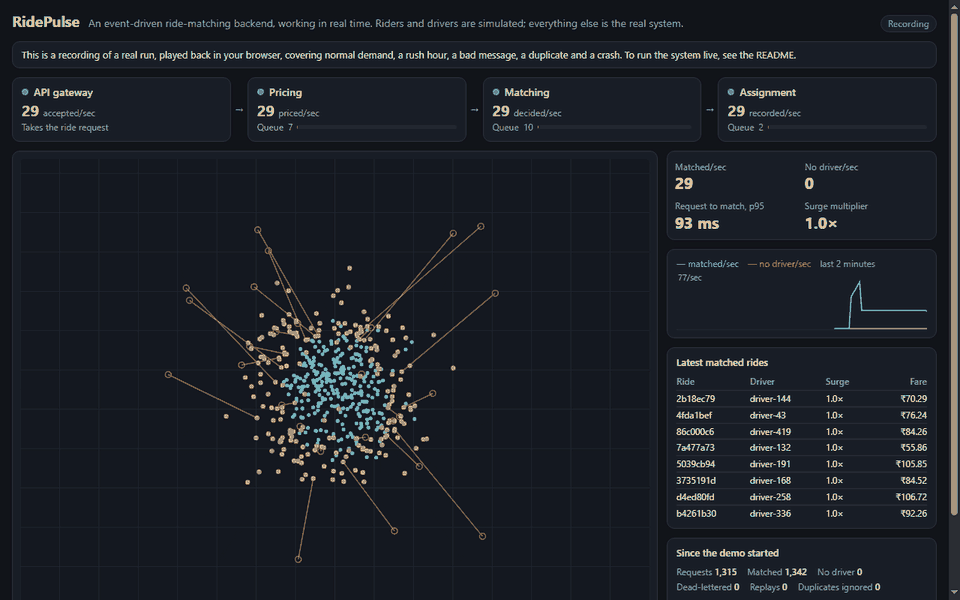
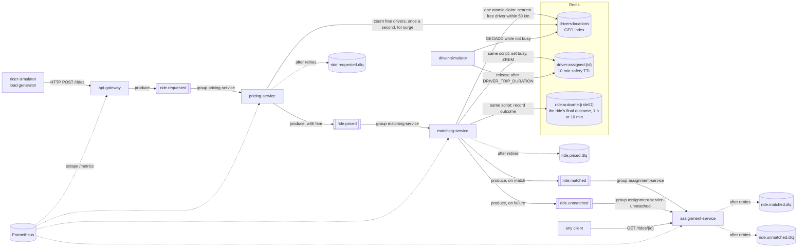
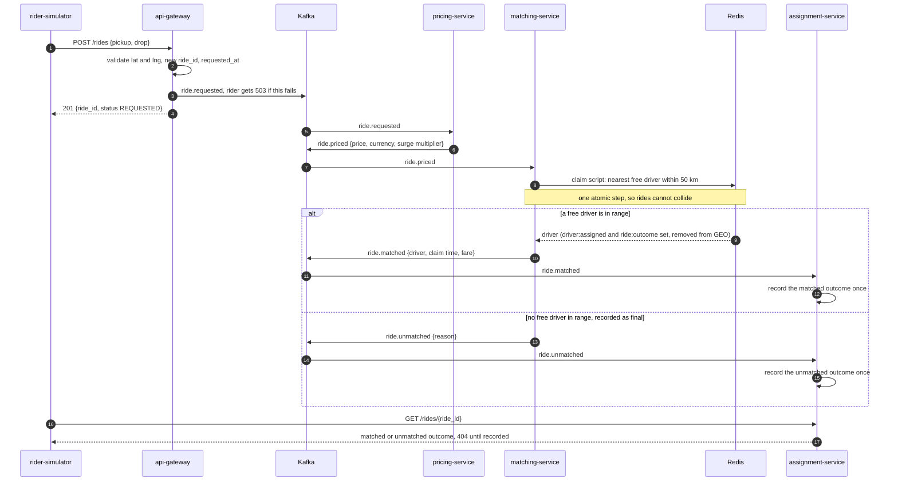

# RidePulse

Event-driven ride matching in Go: Kafka between every stage, Redis GEO for nearby-driver search, an atomic Redis claim for driver assignment, and Prometheus metrics end to end, load-tested with an automated RPS ladder.

[](https://github.com/coderconnoisseur/ridepulse/actions/workflows/ci.yml)


## See it running



The dashboard shows the whole system on one page: a live map, each service's rate and Kafka queue, fares and surge. You can raise demand, trigger a rush hour, send a corrupt message, deliver a ride twice, or crash the matching service and watch it recover. Riders and drivers are simulated; the services, Kafka and Redis are real.

**Run it yourself.** You need [Docker](https://www.docker.com/products/docker-desktop/), about 1 GB of free memory, and nothing else. Clone the repo, then double-click `demo.bat` on Windows, or run:

```bash
./demo.sh
```

Or start it directly, and open http://localhost:8090:

```bash
docker compose up -d --wait dashboard
```

The first run can take several minutes if it has to build the image. Stop it with `docker compose down`.

The dashboard is only reachable from your machine. Its crash button needs access to Docker, and can only kill and restart the matching container.

## Results at a glance

From the committed benchmark run ([`benchmark-results.csv`](tools/benchmark/benchmark-results.csv)): one run on an 8-core Windows machine that also hosted Docker, Kafka, Redis and the load generator, with single-partition topics, 1,000 drivers and 5 s trips.

- **Accepts about 1,500 RPS:** the gateway held targets up to 800 RPS and accepted 1,569 RPS at a 1,600 target, with no publish errors in any measurement window.
- **Every ride gets one outcome:** all 212,751 requests ended matched or unmatched. None reached a dead-letter topic and no backlog remained.
- **Fast under load:** end-to-end p95 for matched rides was 190 ms at 800 RPS, and about 1.1 s at the top step.
- **Matched rides are limited by driver supply:** about 160/sec with these settings, so most rides at high load are recorded as unmatched. That's expected, not an error. With 1 s trips, a separate earlier run reached about 450/sec.
- **Guarantees hold through crashes:** with matching and pricing force-killed under load, no ride was lost, none got two drivers, and no driver had overlapping rides ([details](docs/matching-under-load.md#live-audit-of-the-guarantees)).

**Core focus areas:**
- Low-latency geospatial matching
- Atomic driver assignment with no locks or collisions
- Root-cause diagnosis of behaviour under load, from measurements
- Observability-driven performance tuning end-to-end

---

## Architecture Overview

RidePulse follows an event-driven microservices design where each component has a single, well-scoped responsibility:



Every arrow above is a real code path. Each consumer runs in its own consumer group, and a message that still fails after retries is dead-lettered to `<topic>.dlq` with `x-error` and `x-original-*` headers. The driver simulator is not an event consumer: it writes locations straight to Redis and deletes `driver:assigned:{id}` when a trip ends.

The `ride.*` payloads share one contract, [`pkg/events`](pkg/events/events.go): snake_case JSON and a `v` version field (currently `1`).

| Component | Role |
|---|---|
| **Rider Simulator** | Generates ride requests at configurable RPS against the HTTP gateway |
| **API Gateway** | Accepts `POST /rides`, publishes `ride.requested` to Kafka |
| **Pricing Service** | Consumes `ride.requested`, computes the fare with city-wide surge, publishes `ride.priced`; failures retried, then dead-lettered to `ride.requested.dlq` |
| **Matching Service** | Consumes `ride.priced`, atomically decides the ride's outcome once (nearest free driver or no driver), publishes `ride.matched` with the fare, or `ride.unmatched` with reason `no_drivers`; infrastructure failures retried, then dead-lettered to `ride.priced.dlq` |
| **Assignment Service** | Consumes `ride.matched` and `ride.unmatched`, records each ride's outcome and fare once (duplicates ignored), exposes end-to-end latency metrics and `GET /rides/<id>`; outcomes are kept in memory; dead-letters to `ride.matched.dlq` / `ride.unmatched.dlq` |
| **Driver Simulator** | Continuously updates live driver locations in Redis GEO; keeps assigned drivers out of the GEO set and releases them after `DRIVER_TRIP_DURATION` |
| **Event contracts** (`pkg/events`) | Shared snake_case JSON types for `ride.requested`, `ride.priced`, `ride.matched` and `ride.unmatched`; every service imports them instead of keeping its own copy |
| **Shared runtime** (`pkg/kafkaconsumer`, `pkg/health`) | At-least-once consumer runner with ordered commits and DLQs; liveness and readiness handlers |
| **Kafka** | Decouples every stage of the pipeline |
| **Redis** | GEO indexing and driver assignment state, with one Lua script performing each claim atomically |
| **Prometheus** | Latency and success-rate monitoring at every stage |
| **Dashboard** (demo only) | Generates simulated rides, reads Kafka, Redis and each service's metrics, and serves the live page |

---

## Request Flow

One ride, from `POST /rides` to a lookup of its outcome:



Latency is measured from `requested_at` (stamped at the gateway) to the terminal consumer, so the same number covers every stage.

---

## Core Engineering Decisions

### 1. Geospatial Indexing with Redis GEO

Driver locations are stored and queried using Redis's native GEO commands, enabling sub-millisecond radius-based lookups without a dedicated spatial database. This keeps the hot path lean and the driver discovery step real-time.

### 2. Atomic driver claim

One Lua script decides each ride's outcome once. It finds the nearest free driver within 50 km by straight-line distance, marks them busy, records the outcome and removes them from the GEO set in a single step. If no driver is free, it records that too. Redis runs scripts one at a time, so two rides can't collide over a driver, each ride costs one Redis call, and a redelivered ride always gets the same outcome.

This replaced a design of per-driver locks, parallel batches and phantom-lock release, after measurements showed it was the bottleneck: about 298,000 lock attempts for 5,905 matches in one run. It needs a single Redis instance, not Redis Cluster.

Full write-up: [matching-under-load.md](docs/matching-under-load.md).

### 3. Kafka batch window above the broker round trip

`kafka-go` closes batches on a timer and sends them one at a time per partition. A window shorter than a broker round trip builds a queue that grows under load, which caused publish timeouts, duplicates and dead letters. The window is now 25 ms with a 2 s publish budget. The cost is higher latency at low load: median end-to-end latency at 50 RPS rose from 40 ms to about 85 ms.

### 4. At-least-once consumers with ordered commits and DLQs

Pricing, matching and assignment share one runner (`pkg/kafkaconsumer`). An offset is committed only after its message, and every earlier message of the partition, was handled or dead-lettered, so a crash redelivers instead of losing work. Failed handlers are retried with backoff, then written to `<topic>.dlq` with `x-error` / `x-original-*` headers; a handler panic is dead-lettered without retries instead of crashing the process; a consumer-group rewind starts a new tracker epoch so stale completions cannot corrupt commits; shutdown drains in-flight messages for up to 10 s.

Full write-up: [at-least-once-consumers.md](docs/at-least-once-consumers.md).

### 5. Driver state model and idempotent matching

A matched driver is genuinely busy: the claim script sets `driver:assigned:<id>`, writes `ride:outcome:<rideID>` and removes the driver from the GEO set; the driver simulator ends the trip after `DRIVER_TRIP_DURATION` (default `5s`). Because the script first checks `ride:outcome:<rideID>`, a retry or Kafka redelivery gets the same result: the same driver with the original claim time, or no driver.

Full write-up: [driver-state-model.md](docs/driver-state-model.md).

### 6. Fares and surge

The fare is `(₹50 + ₹12 × km) × surge`, rounded to paise. Distance is the straight line between pickup and drop (haversine), not the road distance. The fare travels on `ride.priced` and `ride.matched`, so `GET /rides/<id>` can show it.

Surge is city-wide, with no zones. Once a second, pricing compares rides requested in the last 5 s with drivers free right now. It stays at 1.0 until demand exceeds supply, then follows the ratio in steps of 0.1, up to 3.0. If Redis can't be reached, riders pay the normal fare. Pricing a ride never waits on Redis.

The simulated riders don't react to price, so surge here doesn't reduce demand as it would in a real market.

### 7. Worker Pool with Bounded Concurrency

The shared consumer runner (`pkg/kafkaconsumer`) hands each fetched message to a fixed number of workers over an unbuffered channel. This provides natural backpressure — if handlers fall behind, fetching blocks rather than spawning unbounded goroutines or buffering messages, preventing memory blowup under load spikes.

### 8. Observability-Driven Tuning

Every stage exposes Prometheus metrics on its own port. `RequestedAt` is stamped at the api-gateway and propagated through every event so the terminal consumer can measure true end-to-end latency, not just per-stage latency.

Key exports:
- `gateway_request_duration_seconds`, `gateway_requests_total`, `gateway_publish_errors_total`
- `pricing_processing_duration_seconds`, `pricing_events_published_total`, `pricing_surge_multiplier`
- `matching_latency_seconds`, `matching_success_total`, `matching_failures_total`, `match_unmatched_published_total{reason}`
- `driver_claim_latency_seconds`
- `end_to_end_latency_seconds`, `assignments_total` (each ride counted once), `assignment_duplicates_total`
- `unmatched_total{reason}`, `unmatched_duplicates_total`, `unmatched_end_to_end_latency_seconds`
- `pricing_retries_total`, `matching_retries_total`, `pricing_dlq_messages_total`, `matching_dlq_messages_total`, `assignment_dlq_messages_total`, `match_idempotent_replays_total`

---

## Benchmarks

The [`tools/benchmark`](tools/benchmark) runner walks a configurable RPS ladder against a running cluster, samples Prometheus at each step, and writes one CSV row per step.


The latest run is committed here:

📊 **[tools/benchmark/benchmark-results.csv](tools/benchmark/benchmark-results.csv)**

| Target RPS | Gateway intake | Matched/sec | Unmatched/sec | E2E p50 | E2E p95 | Surge at end of step |
|---|---|---|---|---|---|---|
| 50 | 50 | 50 | 0 | 85 ms | 188 ms | 1.0 |
| 100 | 100 | 100 | 0 | 80 ms | 174 ms | 1.2 |
| 200 | 200 | 157 | 43 | 84 ms | 185 ms | 3.0 |
| 300 | 300 | 160 | 141 | 85 ms | 183 ms | 3.0 |
| 500 | 500 | 159 | 341 | 94 ms | 190 ms | 3.0 |
| 800 | 800 | 160 | 641 | 100 ms | 190 ms | 3.0 |
| 1,200 | 1,184 | 160 | 1,027 | 166 ms | 362 ms | 3.0 |
| 1,600 | 1,569 | 155 | 1,417 | 218 ms | 1,105 ms | 3.0 |

End-to-end latency covers matched rides. Matched rides level off because each driver is busy for a 5 s trip, so unmatched rides above that rate are expected. This is a single run on a shared machine, so treat the numbers as indicative. [matching-under-load.md](docs/matching-under-load.md) explains how the first live run's collapse at 800 RPS was diagnosed and fixed.

See [rps-benchmarking-setup.md](docs/rps-benchmarking-setup.md) for the runbook, ladder shape, PromQL queries, and interpretation notes.

---

## Known limitations and next steps

- **Limits at the top of the ladder aren't isolated.** Gateway p95 rises and intake falls short of target near 1,500 RPS. Everything shares one machine, so it may be the machine rather than the code.
- **Higher latency at low load.** The 25 ms batch window adds time at each Kafka hop, so median end-to-end latency is about 80-85 ms even when idle.
- **A single Redis instance is required.** The claim script builds key names at runtime, so it won't run on Redis Cluster as written. Ride outcomes live only in Redis, so losing Redis data would also lose duplicate protection.
- **A rider can hear about a driver late after a crash.** A ride claimed just before a crash is announced after the restart, about 30 s later in testing, and possibly after the simulated trip has ended. `matched_at` shows the true claim time, but the late announcement remains.
- **A redelivered ride can be quoted twice.** If pricing crashes, a redelivered ride can get a second price when surge has changed. The first result recorded by assignment-service stands.
- **A dead-lettered ride has no outcome.** If a ride reaches `ride.priced.dlq`, nothing tells the rider or replays it. If it had already claimed a driver, that driver makes a simulated trip for nobody.
- **Matching is simple.** A driver up to 50 km away can be matched, the radius is fixed, and distance is straight-line. There's no ETA, rating, or accept/decline.
- **There are no riders or trips as such.** Requests have no rider identity or login, the gateway has no rate limiting, and a trip is a timer: drivers don't move to the pickup or drop.
- **The event version isn't enforced.** Events carry `v`, but consumers don't check it yet.
- **Single-partition Kafka topics.** One partition per topic caps consumer parallelism per service. Next: create topics with more partitions, partition by ride ID and run multiple consumers per stage. Until then the rewind handling below is not exercised.
- **Rewind detection is partial.** The offset tracker detects a rewind only when a re-fetched offset is at or below the last offset it tracked. A partition re-assigned starting *above* that offset is not detected, so the committed offset can move backwards and messages are redelivered. That stays within at-least-once, and handlers absorb duplicates.
- **Two readers, two consumer groups.** assignment-service reads `ride.matched` in group `assignment-service` and `ride.unmatched` in group `assignment-service-unmatched`. A shared group would make the leader's metadata request for both topics fail as a whole while `ride.unmatched` does not exist yet (it is created lazily on the first business failure), stalling the success path too; with separate groups a missing `ride.unmatched` topic only delays the unmatched reader, and rebalances are independent.
- **In-memory assignment store.** The assignment service keeps ride outcomes (matched and unmatched) in maps for benchmark verification; nothing is persisted, so after a restart a redelivered event is counted as new.
- **End-to-end coverage is one scenario.** `tools/e2e` runs on every CI build against real Kafka and Redis: load, a rush hour, a corrupt message, a duplicate and a force-kill of matching, then it checks the guarantees against the raw Kafka topics. Pricing crashes and consumer-group rewinds are only covered by the hand runs and unit tests. Unit tests cover the at-least-once consumer runner (ordered commits, retries, DLQ, drain, rewind epochs, panic recovery), surge rules, and the driver claim script (nearest-first, replay, final outcomes, concurrent claims) against an in-process Redis (miniredis), the shared event contracts (JSON round trips), the gateway's coordinate validation and the health probes.
- **Readiness probes are shallow.** `/ready` checks that a broker accepts a TCP connection (and Redis answers `PING`). It does not verify that the topics exist or that consumer groups are assigned partitions.

---

## Documentation

New here? Start with **[How RidePulse works, in simple terms](docs/how-it-works.md)**.

Deep-dive engineering notes on the correctness and reliability changes:

- 📄 [Finding what limited RidePulse under load](docs/matching-under-load.md)
- 📄 [At-least-once consumers](docs/at-least-once-consumers.md)
- 📄 [Driver state model](docs/driver-state-model.md)
- 📄 [RPS benchmarking setup](docs/rps-benchmarking-setup.md)

Earlier locking work, since replaced: [phantom-lock fix](docs/phantom-lock-fix.md), [deadline fix](docs/deadline-fix.md), [shuffle fix](docs/shuffle-nearest-first-fix.md).

---

## Tech Stack

- **Go 1.25** — Concurrency primitives, goroutines, contexts; Gin for the HTTP gateway
- **Kafka** — Event streaming and ingestion decoupling
- **Redis** — GEO indexing and atomic driver assignment with a Lua script
- **Docker Compose** — Infrastructure orchestration
- **Prometheus** — Metrics and observability

---

## Running RidePulse

To see it working, use the [demo](#see-it-running). The steps below run each service by hand, for development and benchmarking.

### Prerequisites

- Docker with Compose (`docker compose`, or the older `docker-compose`)
- Go 1.25.6+ (the version in each `go.mod`)

### 1. Start Infrastructure

From `deployment/`, bring up Kafka, Zookeeper, Redis, and Prometheus:

```bash
cd deployment
docker compose up -d
```

Verify:
- Kafka: `localhost:9092`
- Redis: `localhost:6379`
- Prometheus UI: http://localhost:9090

### 2. Start the services (one terminal each, from the repo root)

```bash
cd services/matching-service   && go run cmd/matching-service/main.go
cd services/pricing-service    && go run cmd/pricing-service/main.go
cd services/assignment-service && go run cmd/assignment-service/main.go
cd services/driver-simulator   && go run cmd/driver-simulator/main.go
cd services/api-gateway        && go run cmd/api-gateway/main.go
```

Prometheus scrape targets:

| Service | `/metrics` endpoint |
|---|---|
| api-gateway | `:8080/metrics` |
| pricing-service | `:2115/metrics` |
| matching-service | `:2112/metrics` |
| assignment-service | `:2114/metrics` |

Confirm all four are `up` at http://localhost:9090/targets.

**Health endpoints.** Each service answers two probes on the same port as its HTTP or metrics server:

| Service | Port | `GET /health` (liveness) | `GET /ready` (readiness) |
|---|---|---|---|
| api-gateway | `HTTP_ADDR` (`:8080`) | 200 while the process serves HTTP | Kafka |
| pricing-service | `METRICS_ADDR` (`:2115`) | 200 while the process serves HTTP | Kafka |
| matching-service | `METRICS_ADDR` (`:2112`) | 200 while the process serves HTTP | Kafka and Redis `PING` |
| assignment-service | `HTTP_ADDR` (`:2114`) | 200 while the process serves HTTP | Kafka |

`/ready` returns `200 {"status":"ready"}` when every check passes, or `503` with the failing checks listed under `failing`. The Kafka check succeeds when any one broker in `KAFKA_BROKERS` accepts a TCP connection. All checks run concurrently under a 1 s budget, and none creates topics or keys.

**Configuration.** Every service reads its endpoints from environment variables; unset or blank values fall back to the defaults below, so the commands above work unchanged on one host. `KAFKA_BROKERS` is a comma-separated list. Invalid values make the services exit at startup, except rider-simulator, which falls back to the default for a non-numeric or non-positive `RIDER_RPS` / `RIDER_CONCURRENCY`; double-check these when running the ladder.

| Variable | Default | Used by | Meaning |
|---|---|---|---|
| `KAFKA_BROKERS` | `localhost:9092` | api-gateway, pricing, matching, assignment | Comma-separated broker list. |
| `REDIS_ADDR` | `localhost:6379` | pricing, matching, driver-simulator | Redis address. |
| `HTTP_ADDR` | `:8080` (api-gateway), `:2114` (assignment) | api-gateway, assignment | HTTP listen address (also serves `/metrics`). |
| `METRICS_ADDR` | `:2115` (pricing), `:2112` (matching) | pricing, matching | Metrics listen address. |
| `MATCH_WORKERS` | `runtime.NumCPU() * 25` | matching | Matcher worker-pool size; positive integer. |
| `REDIS_POOL_SIZE` | `MATCH_WORKERS` | matching | Redis connection pool size; positive integer. Each worker uses one connection at a time. |
| `PRICING_WORKERS` | `runtime.NumCPU() * 25` | pricing | Pricing worker-pool size; positive integer. Each worker blocks on a Kafka publish, so this caps pipeline throughput. |
| `MATCH_DEADLINE` | `500ms` | matching | Timeout for one driver claim (Go duration, positive). A claim that times out is retried. |
| `DRIVER_COUNT` | `1000` | driver-simulator | Number of simulated drivers. |
| `DRIVER_TRIP_DURATION` | `5s` | driver-simulator | How long an assigned driver stays busy (Go duration). |
| `RIDER_URL` | `http://localhost:8080/rides` | rider-simulator | Gateway endpoint to POST rides to. |
| `RIDER_RPS` | `500` | rider-simulator | Target requests per second. |
| `RIDER_CONCURRENCY` | `200` | rider-simulator | Max in-flight requests; sends beyond it are counted as dropped. |

The committed benchmark uses these defaults.

### 3. Send load

**Automated ladder (recommended):**

```bash
cd tools/benchmark
go run cmd/benchmark/main.go
```

Walks `50:20,100:40,200:80,300:120,500:200,800:300` (RPS:concurrency) by default and writes [`benchmark-results.csv`](tools/benchmark/benchmark-results.csv). Configurable via `--ladder`, `--warmup`, `--window`, `--cooldown`, `--output`.

Driver supply is configurable on the driver simulator: `DRIVER_COUNT` (default `1000`), `DRIVER_TRIP_DURATION` (Go duration, default `5s`) and `REDIS_ADDR` (default `localhost:6379`).

**Manual, one RPS level:**

```bash
cd services/rider-simulator
RIDER_RPS=300 RIDER_CONCURRENCY=120 go run cmd/rider-simulator/main.go
```

### 4. Monitor

Prometheus at http://localhost:9090. Key queries:

```promql
# End-to-end assignment rate
rate(assignments_total[1m])

# End-to-end p95 latency
histogram_quantile(0.95, sum by (le) (rate(end_to_end_latency_seconds_bucket[1m])))

# Driver claim latency
histogram_quantile(0.95, sum by (le) (rate(driver_claim_latency_seconds_bucket[1m])))

# Current surge multiplier
pricing_surge_multiplier

# Rides that found no driver
sum by (reason) (rate(unmatched_total[1m]))
```

Verify pipeline closure by querying assignment-service directly:

```bash
curl http://localhost:2114/count            # total matched rides observed
curl http://localhost:2114/assignments/<id> # look up a matched ride (404 if unmatched)
curl http://localhost:2114/rides/<id>       # outcome of any ride: matched or unmatched
```

`GET /rides/<id>` returns `{"ride_id","status":"matched","driver_id","matched_at","latency_ms","price","currency","surge_multiplier"}` or `{"ride_id","status":"unmatched","reason","failed_at"}` (`reason` is `no_drivers`), and 404 for a ride with no outcome yet. `matched_at` is when the driver was claimed.

### 5. Run the checks CI runs

Each service is its own Go module (tied together by `services/go.work` for local development). CI runs `go vet`, `go build`, and `go test` in every module; the unit tests need no Kafka or Redis:

```bash
cd services/matching-service
go vet ./... && go build ./... && go test ./...
```

CI also runs the end-to-end test, which starts the whole stack in Docker and force-kills matching under load. It takes about 2 minutes after the image is built:

```bash
docker compose run --rm --build e2e
```

It sets the demo's demand to 0, so run `docker compose down` afterwards.

## License

[MIT](LICENSE)
